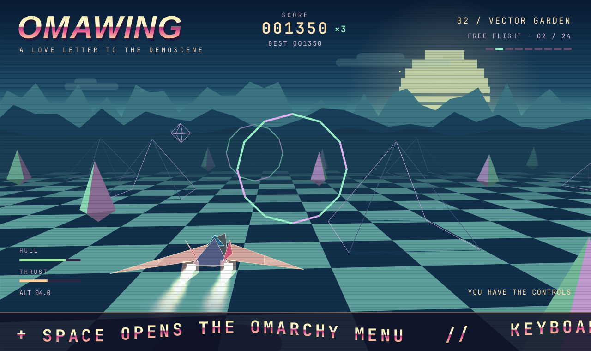

# Omawing



An Amiga-style vector flight demo for Omarchy. A low-poly ship flies over an
endless checkerboard under copper-bar skies, with a chase camera, a sine-wave
scroller, and a three-track MP3 soundtrack with arcade sound effects. Nine
scenes form a 216-second autopilot loop; press any flight key to take the controls and chase a high score.

A small sun sits low between the hills inside rings of soft light, with a
pale crescent moon and a small full one higher up, and a flock of birds
drifting across. Three mountain layers and two cloud layers move at
different speeds as you turn.
The camera follows farther behind the ship and looks ahead toward the horizon.
The wings flex on springs, sweep back under boost, and shake after impacts. Twin
exhaust trails glow and fade with soft, transparent particles.

It is a native Qt Quick app: the flight, the 3D projection, and the audio controls are
C++, and the picture is painted straight into a GPU framebuffer. It began as
an SVG-in-the-browser demo; the renderer is a port of that code.

## Keys

| Key | Action |
| --- | --- |
| A D / ← → | Steer |
| W S / ↑ ↓ | Climb or descend |
| Shift | Boost |
| Drag | Steer with the mouse |
| Space | Pause or play |
| T | Take control or watch the demo |
| N | Next scene |
| M | Turn music on or off |
| E | Turn sound effects on or off |
| V | Music and effects volume |
| U | Show or hide the titles, score, and toolbar (the radar stays) |
| P | Next music track |
| B | Show or hide the Omarchy slogan banner |
| H | Open the local high-score board |
| Esc | Close a panel or leave full screen |
| R | Restart from the beginning |
| F or F11 | Full screen on or off |
| ? | Show or hide shortcuts |
| Q | Quit |

The toolbar appears when the mouse moves and fades out after a few seconds.
Sound stays off until you turn it on; if there is no audio output, the window
says so. Minimizing pauses simulation and sound until the window is restored.

## Soundtrack and effects

The bundled playlist loops in this order:

1. **Pyramids Of Glass** — 3:01
2. **Across the Vector Plane** — 2:56
3. **Velvet Horizon** — 2:55

The three tracks were made with Google Gemini for this project. The sound
effects are generated by `bin/generate-effects`.

Press **M** for music and **E** for sound effects; each is remembered separately.
**V** opens the volume panel: the arrow keys move a slider, Tab switches
between music and effects, and Esc closes it. Levels are saved too. Press **P**, or click the current track
name above the toolbar, to skip. Pausing, muting, opening the score board, and
minimizing preserve the music position; resuming continues where you left off.
Boosts, rings, impacts, and wrecks have separate short effects. Stopping sound
clears effects so old collision noises do not replay when you resume.

The MP3s ship as files in `/usr/share/omawing/music` (in a build tree they are
read from `src/audio`); the short effects are compiled into the executable.
Qt's FFmpeg backend copies a compiled-in track to a temporary file to stream
it and never removes the copy, so the music stays on disk. `bin/generate-effects`
rebuilds the four original WAV cues without touching the soundtrack.

## Radar

A round radar on the right shows the 60 units around the ship from above,
turned so your heading always points up: pyramids as triangles, crystals as
diamonds, the beach ball as a red dot, and the rings you haven't flown
through yet as bars, with the next one ahead in a brighter, thicker line.
Scans ripple out from the ship in rings, lighting each blip as they pass,
and the rim and the crystals flash on the music's beat.

## Moving with the music

While music plays, Omawing listens to it: a copy of the decoded audio goes
through a small beat tracker (the bass through a 120 Hz low-pass, compared
with its recent average). On each kick the crystals swell and brighten softly. The pulse is shaped
to be gentle: it rises over about a tenth of a second and fades slowly,
never pulses more than about twice a second, and never flashes, keeping
well clear of the three flashes a second that photosensitivity guidelines
warn about. With the music off, the
scenery is still.

Every ring you fly through flashes and throws out a ring of glitter, and its
chime climbs a step of a pentatonic scale for each ring in the chain, up to
eight.

## Flying for points

Fly through a ring for **100 points × your combo**. Consecutive rings increase
that combo up to **8×**; boosting doubles the award. A clean pass repairs three
hull points. Each ring can be collected only once per run, in either direction.
Missing a ring or hitting scenery resets the combo.

You start with 100 hull points. Pyramids cost 34, crystals 20, the bouncing ball
25, and a ring rim 12. An impact flashes the hull gauge, shakes the camera,
throws sparks, and gives 1.4 seconds of protection. At zero hull, the ship wrecks
and the autopilot resumes. The demo itself is invulnerable.

A completed run can enter the local top ten. Switching to the demo or restarting
also ends the run; quitting preserves a qualifying score under your last name.
The board pauses the flight while you enter a name. Scores and the banner
preference are stored in `~/.config/omawing/omawing.conf` (or the platform's
`XDG_CONFIG_HOME` equivalent).

## Scenes

Copper Coast · Vector Garden · Star Run · Omarchy · Neon Mirage · Amber Terminal ·
Ice Palace · Lava Fields · C64 Dreams. Each lasts 24 seconds; **N** skips ahead.
The Omarchy scene takes the current desktop theme's colours and name live, and
picking a new theme flies straight into that scene so you see it at once.

## What it follows

- **Any window shape.** The canvas is at least 860 by 540 units and takes the
  window's aspect ratio, so a wide window sees more of the world and a tall
  one more sky and ground. Nothing is letterboxed.
- **The Omarchy theme.** The toolbar and shortcut overlay use the theme's
  accent and Hyprland's window rounding, and follow theme switches live. The
  fourth scene also uses the current theme's palette; the other eight have
  their own colours.
- **The Omarchy language.** Every control and HUD line is translated into
  Omarchy's 50 languages and follows Setup > Language live. Right-to-left
  languages mirror the toolbar. The scene names and the scroller are the
  demo's artwork, like its title, and stay in English.

## Install

Pick whichever you're comfortable trusting. Each installs only files, with no
install scripts: the program, the soundtrack, a launcher entry, an icon, and
the licence. Omawing runs as your user, makes no network connections, and runs
no program other than `hyprctl` (to read the window rounding).

**Build it yourself from the recipe.** This is exactly what the AUR does. Read
[aur/PKGBUILD](aur/PKGBUILD) first if you like; it downloads the tagged source
from this repository, checks its SHA-256, and builds it with Arch's compiler
flags:

```sh
git clone https://github.com/thepixelgardener-create/omawing
cd omawing/aur && makepkg -si
```

**Or download the package GitHub built.** Release packages are built by
[a public workflow](.github/workflows/release.yml) in a clean Arch Linux
container, never on anyone's computer, and carry a signed record of the
workflow and commit that built them. Download `omawing-*.pkg.tar.zst` from the
[latest release](https://github.com/thepixelgardener-create/omawing/releases/latest),
then check it and install it:

```sh
gh attestation verify omawing-0.3.0-1-x86_64.pkg.tar.zst -R thepixelgardener-create/omawing
sudo pacman -U omawing-0.3.0-1-x86_64.pkg.tar.zst
```

`yay -S omawing` will work once the package is on the AUR; new AUR accounts
are paused at the moment.

To try it without installing anything:

```sh
git clone https://github.com/thepixelgardener-create/omawing
cd omawing && bin/build && build/omawing
```

## Build and install from a clone

```sh
bin/build      # build/omawing
bin/test       # Qt Test, offscreen; audio checks run silently
bin/benchmark  # GPU rendering benchmark at 1080p and 4K
bin/install    # makepkg -fsi: installs the binary, launcher entry, and icon
```

After `bin/install`, Omawing is in the app launcher (Super + Alt + Space).

`OMAWING_STATS=1 omawing` prints the frame rate, paint time, longest gap between
frames, and the range of simulation steps once a second, logs every hitch (a gap
over 25 ms), and says whether painting runs on the GPU or the CPU.

The renderer rejects invisible polygons early and uses the GPU's convex-polygon
path for the checkerboard and meshes. It retains native resolution and the full
nine-scene sequence. `bin/benchmark` measures complete GPU frames (including a
GPU finish), so its timings differ from the CPU paint timings in `OMAWING_STATS`.

## Source

| File | Job |
| --- | --- |
| `src/flight.{h,cpp}` | The ship, chase camera, particles, scenery layout, and act timing. No Qt types. |
| `src/game.{h,cpp}` | The arcade rules: rings, the multiplier, hull damage, and wrecks. No Qt types. |
| `src/geometry.h` | Vector helpers, in namespace `geo`. |
| `src/scene.{h,cpp}` | Puts a frame together from the layers below. |
| `src/view.{h,cpp}` | What the layers share: projection, clipping, fog, and the act's colours and style. |
| `src/sky.{h,cpp}` | Sky, copper bars, stars, sun, clouds, parallax hills, and the ground's gradient. |
| `src/ground.{h,cpp}` | The checkerboard, grid lines, and the ship's shadow. |
| `src/worldlayer.{h,cpp}` | Scenery, rings, the ship, and particles, sorted far to near. |
| `src/overlay.{h,cpp}` | Speed lines, ring points, scanlines, title, HUD, radar, and the sine scroller. |
| `src/shipshape.h` | The hull and wing geometry, shared by the ship and its shadow. |
| `src/scoreboard.{h,cpp}` | The saved top ten, as a list model for QML. |
| `src/audio.{h,cpp}` | The MP3 playlist and gameplay effects, through Qt Multimedia. |
| `src/backend.{h,cpp}` | State and actions for QML: pause, autopilot, sound, input, and preferences. |
| `src/flightview.{h,cpp}` | The Qt Quick item that paints the scene. |
| `src/Main.qml` | The window, toolbar, shortcut overlay, volume panel, and high-score board. |
| `src/theme.*`, `src/translator.*` | Omarchy colours, rounding, and language. |

## Limits

Collisions use simple ship-centred bounds rather than exact wing geometry.
Faces are sorted by average depth, so intersecting geometry can occasionally
overlap wrongly. The high-score board is local to this computer.
