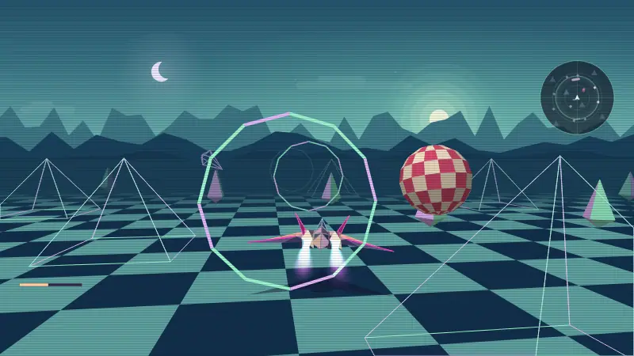
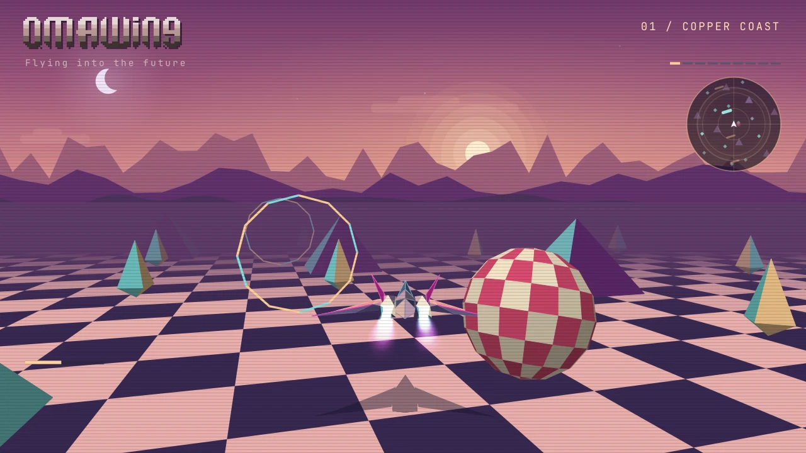
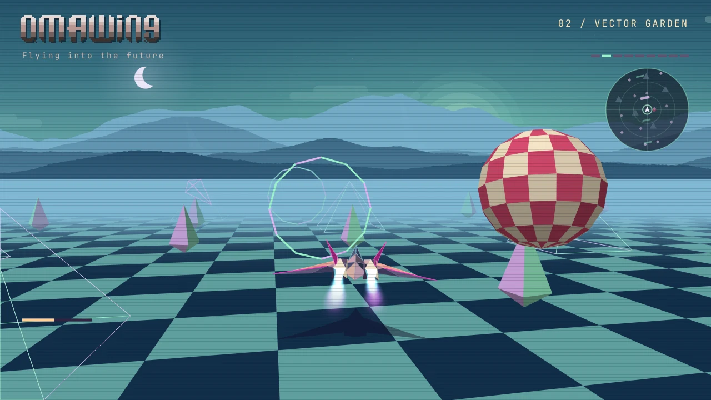
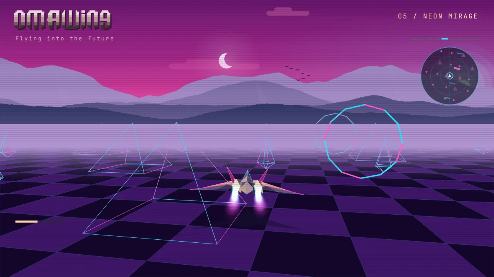
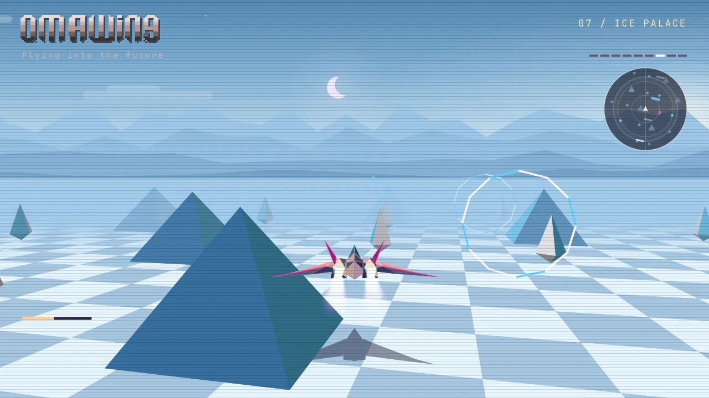

# Gallery

[Home](../README.md) · [Gallery](gallery.md) · [Playing](playing.md) · [Install](install.md) · [Development](development.md)

Eight seconds of the Vector Garden, followed by four of Omawing's nine scenes.
These are frames from the game's renderer using the current ship and camera.
The animated WebP loops silently; music and effects are available in the game.

| Copper Coast | Vector Garden |
| --- | --- |
|  |  |
| Neon Mirage | Ice Palace |
|  |  |

Select a still to view it at full size. Press **N** in-game to cycle through
all nine scenes, or let the 216-second demo play through them.
